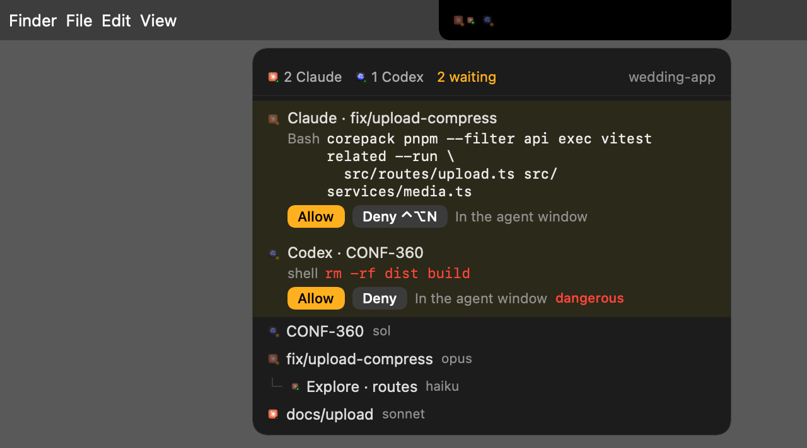
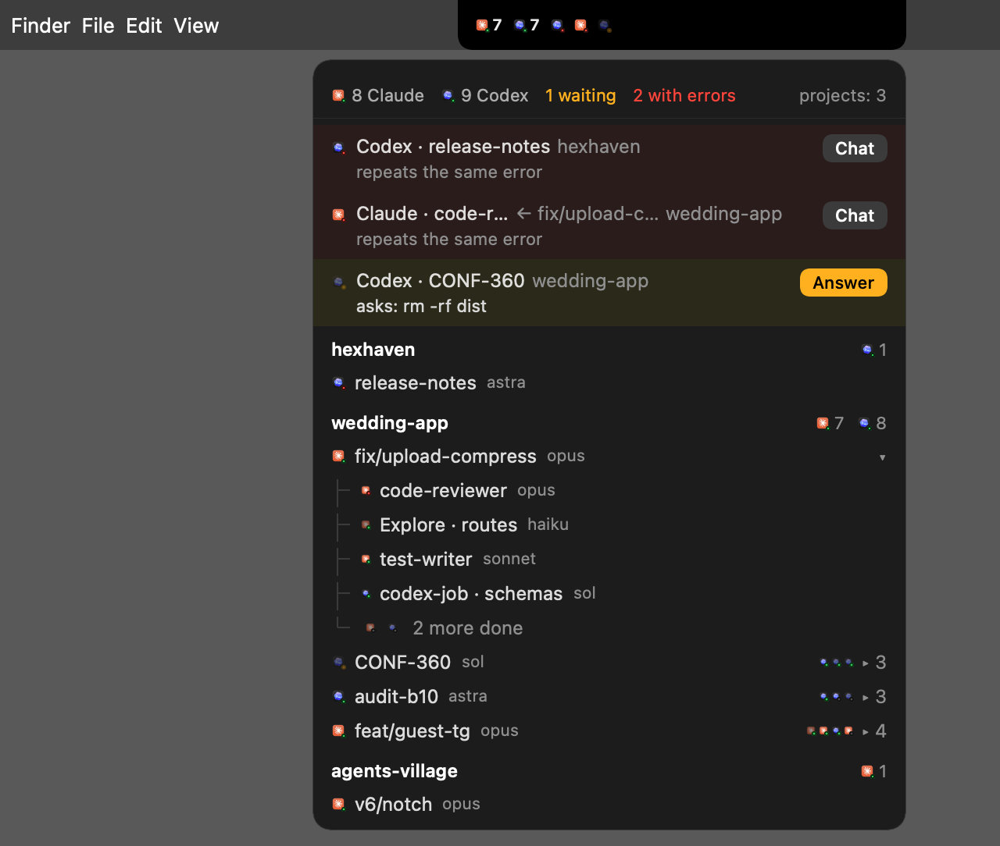

<div align="center">


# Agent Notch

**Your Claude Code and Codex agents, live in the MacBook notch.**<br>
See who is working, who is stuck and who is waiting for you. Approve their commands without leaving what you're doing.

[](https://github.com/Forichok/Agent-Notch/releases/latest)
[](https://github.com/Forichok/Agent-Notch/releases)

[](LICENSE)


```bash
brew install --cask forichok/tap/agent-notch
```

[Download DMG](https://github.com/Forichok/Agent-Notch/releases/latest) · [Watch the 30-second video](assets/agent-notch-promo.mp4) · [Русский](README.ru.md)

</div>

---

You start a few agents in Claude Code, two Codex workers on another repo, and a subagent fans out into five more. Twenty minutes later one of them has been sitting on `Allow rm -rf dist?` the whole time, and you only find out when you switch windows.

Agent Notch puts a small wing to the left of the notch. One mark per agent. A glance tells you how many are running and whether anyone needs you, and a click answers them.

It reads the session logs Claude Code and Codex already write to `~/.claude` and `~/.codex`. Nothing leaves your Mac: no account, no telemetry, no network calls.

## Read the wing in one second

| | Means |
|---|---|
| **Logo** | Vendor: Claude or Codex, taken from the app installed on your Mac |
| **Brightness** | Model weight: full for opus, sonnet, sol and astra; dimmed for haiku and luna |
| **Dot** | 🟢 working · 🟡 blinking, waiting for you · 🔴 stuck repeating an error · ⚪ finished |
| **Size** | Subagents are smaller and sit right next to their parent |

Prefer plain shapes? Settings switch the marks to dots (circle Claude, square Codex, ring for light models) or to logos tinted by state.

Past six live agents in a project, the marks fold into counters like `● 6 ■ 7`; waiting and failing agents always keep their own mark. If the menu bar of the active app reaches the wing, it can collapse into one summary (turn it on from the right-click menu; it needs Accessibility permission). On a Mac without a notch the wing becomes a regular menu bar item.

## Answer agents from the notch

Install the hooks once, and a permission request stops waiting silently in a terminal you can't see. The list opens, a sound plays, and the full command is shown exactly as the agent will run it.

- **Allow** — click, or press <kbd>⌃</kbd><kbd>⌥</kbd><kbd>Y</kbd>
- **Deny** — click, or press <kbd>⌃</kbd><kbd>⌥</kbd><kbd>N</kbd>
- **Always** — for Claude, save a rule such as `pnpm test *` for this project
- **In agent window** — hand the question back to Claude Code or Codex

`rm -rf`, `sudo`, `git push --force`, `git reset --hard`, multi-line and very long commands are painted red and can only be approved with a mouse click. Hotkeys act on the oldest request, and only after it has been visible for half a second.

Questions (`AskUserQuestion`) get their options as buttons plus a free-text answer. Plans (`ExitPlanMode`) can be accepted or sent back with a comment.

Nothing is ever approved without a human click. If no one answers in 100 seconds, or the app isn't running, the hook steps aside and the agent asks in its own window as usual. Every decision is appended to `~/Library/Application Support/AgentsNotch/decisions.jsonl`.

<p align="center"></p>

## Everything else

- **Projects → sessions → subagents**, grouped by git root, so worktrees land in their repo. Big calm families of subagents fold away.
- **What each agent is doing right now**, under its name: `Bash · pnpm test`, `Edit · src/app.ts`.
- **Agent card** with tabs: done, remaining, files changed with +/−, and the log of commands and tests.
- **Usage at a glance**: Claude and Codex plan limits (Codex with reset times), a context ring per agent, approximate session cost and today's spend.
- **Jump back**: a click opens the chat in the Claude or Codex app (`claude://`, `codex://`); without the app it resumes the session in Terminal.
- **Finish toast** under the notch when an agent is done.
- **Settings** with three presets: brief, detailed, everything.

<p align="center"></p>

## Install

**Homebrew** (recommended):

```bash
brew install --cask forichok/tap/agent-notch
```

**DMG**: grab it from [Releases](https://github.com/Forichok/Agent-Notch/releases/latest) and drag Agent Notch to Applications. The app is open source and not notarized yet, so macOS blocks the first launch of a downloaded copy. Run

```bash
xattr -dr com.apple.quarantine "/Applications/Agent Notch.app"
```

or open it once, then click **Open Anyway** in System Settings → Privacy & Security. Homebrew handles this for you.

**Hooks** (for answering from the notch): right-click the wing → install hooks, or

```bash
"/Applications/Agent Notch.app/Contents/MacOS/AgentsNotch" --install-hooks
```

This adds entries to `~/.claude/settings.json` and `~/.codex/hooks.json`. Other hooks and key order stay as they were, and the original file is kept next to it as `*.agents-notch-backup`. Codex runs new hooks only after you trust them: open Codex, type `/hooks` and mark `notch-hook` as trusted. `--uninstall-hooks` takes them out again.

Requirements: macOS 14 Sonoma or later, Apple Silicon.

## Shortcuts

| Keys | Action |
|---|---|
| <kbd>⌃</kbd><kbd>⌥</kbd><kbd>A</kbd> | Open or close the list |
| <kbd>⌃</kbd><kbd>⌥</kbd><kbd>Y</kbd> | Allow the oldest visible request |
| <kbd>⌃</kbd><kbd>⌥</kbd><kbd>N</kbd> | Deny the oldest visible request |
| Click the wing | Open the list |
| Right-click the wing | Menu: hooks, sound, launch at login, quit |
| Double-click a row | Open that agent's window |

## Privacy and security

- Reads the files Claude Code and Codex keep under `~/.claude` and `~/.codex`, plus the Claude app's plan-usage file in `~/Library/Application Support`. Makes no network requests.
- The hook is a tiny binary, `notch-hook`. It talks to the app over a Unix socket that only your user can open, and exits in milliseconds when the app isn't running.
- The app never approves anything on its own. Timeouts fall back to the agent's own prompt.
- Found a hole? See [SECURITY.md](SECURITY.md).

## FAQ

**Does it work with Claude Code in the terminal, in VS Code, in the desktop app?**
Yes. It watches the session logs, so it doesn't matter where the session runs.

**Do I need the hooks?**
No. Without hooks you still see every agent and its state. Hooks are what let you answer from the notch.

**What language is the interface in?**
English by default, Russian when Russian is the first language in System Settings. To pick one by hand, start the app with `AGENT_NOTCH_LANG=en` or `AGENT_NOTCH_LANG=ru`.

**Intel Macs?**
Not yet. Releases are built for Apple Silicon only.

## Build from source

Needs Xcode (Command Line Tools alone ship a compiler that doesn't match the SDK).

```bash
git clone https://github.com/Forichok/Agent-Notch.git && cd Agent-Notch
./scripts/test.sh     # core checks; exit code 0 means all pass
./scripts/build.sh    # build/AgentsNotch.app, ad-hoc signed
open build/AgentsNotch.app
```

`--fixture multi|projects|heavy|ask|question|plan` shows a made-up scene instead of your logs; `--snapshot <dir>` renders every scene to PNG and exits. The promo video lives in [`promo/`](promo/) and is a [Remotion](https://www.remotion.dev) project.

Code map: `Sources/NotchCore` reads the logs, builds the agent tree, lays out the wing and runs the hook server, with no AppKit. `Sources/NotchHook` is the hook binary. `Sources/AgentsNotch` is the AppKit and SwiftUI shell.

## Contributing

Issues and pull requests are welcome. Run `./scripts/test.sh` before sending a PR; see [CONTRIBUTING.md](CONTRIBUTING.md).

Agent Notch is an independent project. It is not affiliated with Anthropic or OpenAI. Claude and Codex are trademarks of their owners.

## License

[MIT](LICENSE) © 2026 Nikita Udalov
