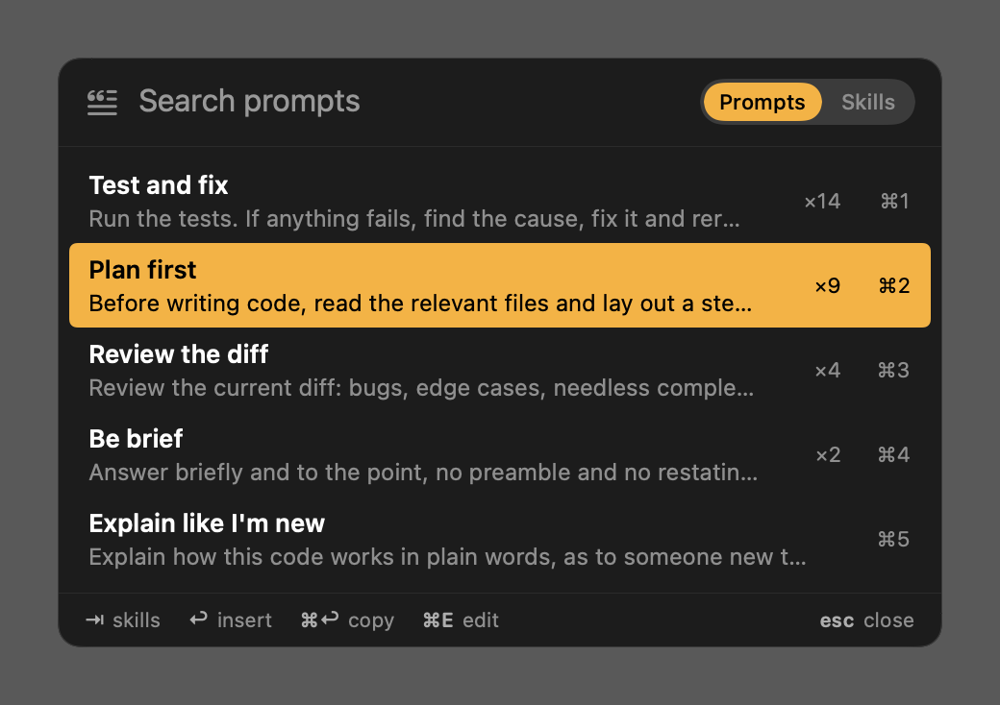
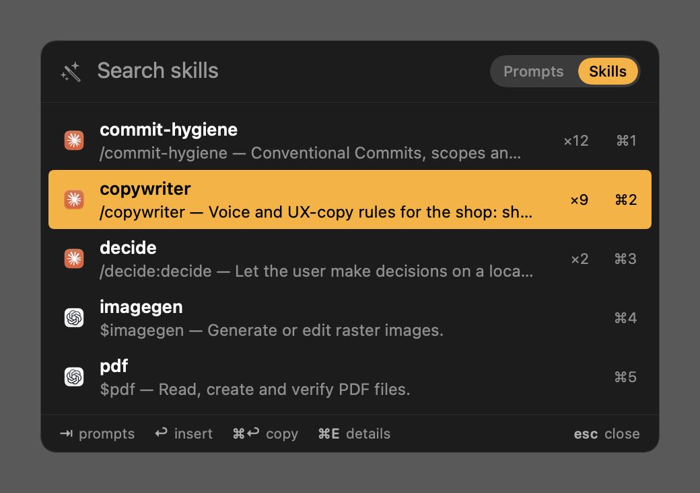
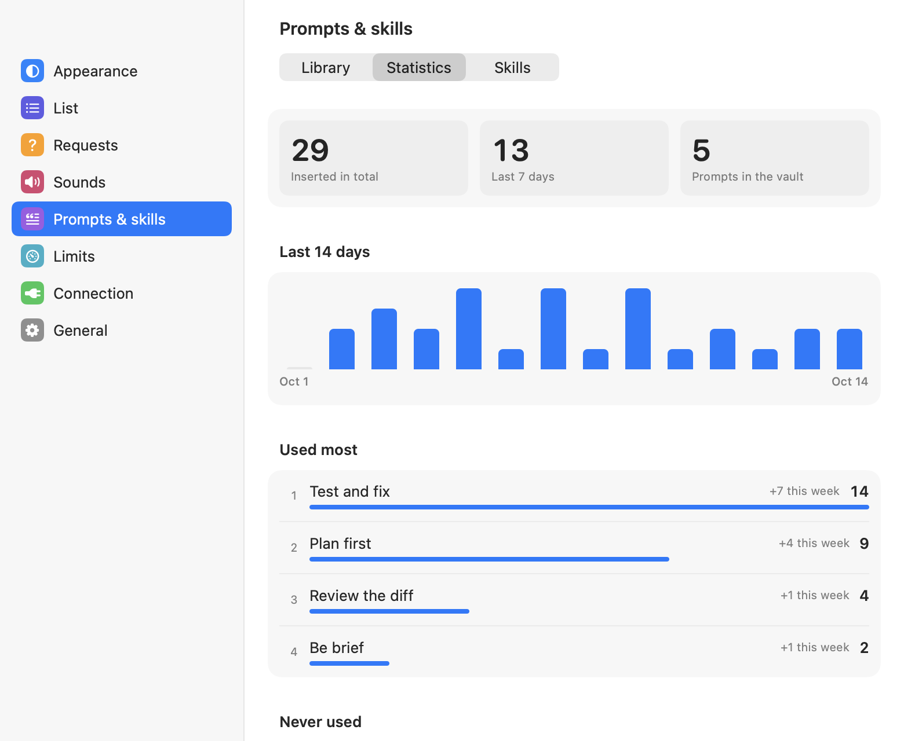
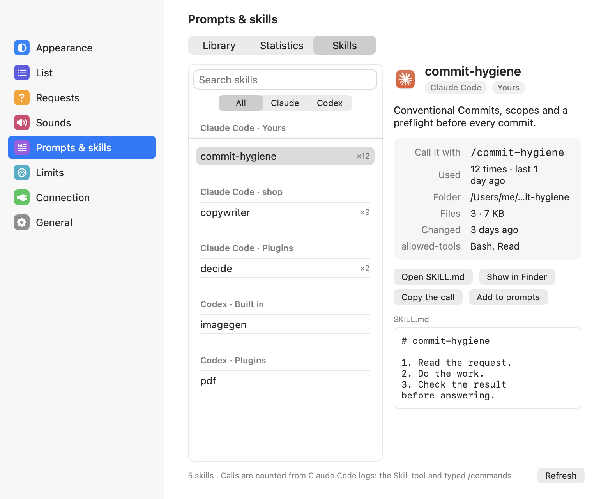

<div align="center">

<picture>
  <source media="(prefers-color-scheme: dark)" srcset="assets/readme/hero-dark.svg">
  
</picture>

**Your Claude Code and Codex agents, live in the MacBook notch.**<br>
See who's working and who's waiting for you. Approve commands without switching windows.

[](https://github.com/Forichok/Agent-Notch/releases/latest)
[](https://github.com/Forichok/Agent-Notch/releases)

[](LICENSE)

```bash
brew install --cask forichok/tap/agent-notch
```

[Download DMG](https://github.com/Forichok/Agent-Notch/releases/latest) · [Watch the film (72 s)](https://github.com/user-attachments/assets/e0233797-1f4f-46ff-a82c-b08d428b05c9) · [Русский](README.ru.md)


</div>

## Why

You run three Claude Code sessions and a couple of Codex workers. One of them has been sitting on `rm -rf dist?` for twenty minutes, and you find out only when you switch windows.

Agent Notch puts one mark per agent beside the notch. A glance shows who is busy, and a click answers whoever is waiting. It reads the logs Claude Code and Codex already keep on your Mac and makes no network requests.

## How to read the wing

| Logo | Brightness | Dot |
|---|---|---|
| Claude or Codex | Full for big models, dimmed for haiku and luna | 🟢 working · 🟡 waiting for you · 🔴 stuck · ⚪ done |

Subagents are smaller and sit next to their parent. Past six agents in a project, the marks fold into counters.


## Answer from the notch

<table>
<tr>
<td width="50%"></td>
<td width="50%"></td>
</tr>
<tr>
<td valign="top"><b>Permissions, questions, plans.</b> Allow with <kbd>⌃⌥Y</kbd>, deny with <kbd>⌃⌥N</kbd>, or pick an answer. Risky commands like <code>rm -rf</code> and <code>git push --force</code> turn red and need a click.</td>
<td valign="top"><b>Every project and subagent.</b> What each agent is running right now, plan limits, context and cost. A click jumps back to its chat.</td>
</tr>
</table>

Nothing is approved without a human click. If nobody answers in 100 seconds, the agent asks in its own window as usual.

## Prompts and skills on a hotkey

<table>
<tr>
<td width="50%"></td>
<td width="50%"></td>
</tr>
<tr>
<td valign="top"><b>Saved prompts.</b> <kbd>⌃⌥P</kbd> opens a search box over any app; <kbd>↩</kbd> pastes the prompt where the cursor is, <kbd>⌘↩</kbd> only copies it, <kbd>⌘1</kbd>–<kbd>⌘9</kbd> picks by row. What you used most lately comes first.</td>
<td valign="top"><b>Installed skills.</b> <kbd>⇥</kbd> switches to every skill Claude Code and Codex can load: yours, built in, from plugins and from your projects. <kbd>↩</kbd> pastes the call: <code>/name</code>, <code>/plugin:name</code> or <code>$name</code>.</td>
</tr>
<tr>
<td width="50%"></td>
<td width="50%"></td>
</tr>
<tr>
<td valign="top"><b>Library and statistics.</b> <b>Settings → Prompts & skills</b> keeps the library (add, edit, duplicate, drag to reorder) and counts insertions: totals, the last 14 days, the most used.</td>
<td valign="top"><b>What each skill is.</b> Description, front matter, files, the SKILL.md itself, and how often Claude Code called it, read from its session logs.</td>
</tr>
</table>

Pasting goes through the clipboard and a ⌘V the app presses, so it needs Accessibility access; without it the prompt is copied. The clipboard is put back right after. Prompts live in `~/Library/Application Support/AgentsNotch/prompts.json`.

## Themes and sounds

Thirteen themes for the list, from plain Terminal to Phosphor, Blueprint, Pixel and Rubber Ducks. Every theme except Terminal can also restyle the marks in the wing.


Sounds are set per event: an agent waits for permission, asks a question, proposes a plan, finishes, fails, or a limit runs low. Out of the box only "waiting for permission" makes a sound. Change it in **Settings → Sounds**.

## Keep the Mac awake with the lid closed


The **Keep awake** switch sits at the top right of the agent list. It uses macOS's `pmset disablesleep` setting and shows the state read back from the system. The setting applies to the whole Mac and stays on after you quit Agent Notch, until you switch it off. Switch it off before putting the Mac in a bag.

To switch without entering a password each time:

1. Right-click the wing and open **Settings → General → Keep awake**.
2. Click **Set up** next to **Passwordless switching** and confirm the permission.
3. Enter an administrator password in the macOS dialog once.

This installs `/private/etc/sudoers.d/agent-notch-keep-awake-<UID>`, a rule for your user that allows exactly `/usr/bin/pmset disablesleep 0` and `/usr/bin/pmset disablesleep 1` as root without a password. Any process running as your user can use this permission. The app validates the rule with `visudo`; it leaves the main sudoers file unchanged.

The settings section shows whether the rule is installed and the result of the last access check. **Check access** verifies the permission using the current sleep setting. If another sudo policy requires a password, the app reports that the rule is ineffective.

Click **Remove permission** in the same settings section to remove the rule. macOS asks for an administrator password to remove it. Removing the permission does not change the current sleep mode: use the panel's **Keep awake** switch to turn that off. The permission also survives uninstalling the app, so remove it in Settings before uninstalling. If the app is already gone, remove the rule in Terminal:

```bash
sudo rm "/private/etc/sudoers.d/agent-notch-keep-awake-$(id -u)"
```

Without this permission, the panel switch still works through the usual macOS administrator dialog. An external `caffeinate` process is not needed.

## Install

```bash
brew install --cask forichok/tap/agent-notch
```

To answer from the notch, right-click the wing and choose **Install Claude Code hooks** and **Install Codex hooks**. Codex also wants you to trust `notch-hook` once: type `/hooks` in Codex.

<details>
<summary>DMG instead of Homebrew</summary>

Download the DMG from [Releases](https://github.com/Forichok/Agent-Notch/releases/latest) and drag the app to Applications. It isn't notarized yet, so clear the download quarantine once:

```bash
xattr -dr com.apple.quarantine "/Applications/Agent Notch.app"
```
</details>

Requires macOS 14+ on Apple Silicon.

## Shortcuts

| | |
|---|---|
| <kbd>⌃⌥A</kbd> | Open or close the list |
| <kbd>⌃⌥Y</kbd> / <kbd>⌃⌥N</kbd> | Allow / deny the oldest request |
| <kbd>⌃⌥P</kbd> | Paste a saved prompt or a skill call; <kbd>⇥</kbd> switches between them |
| Double-click a row | Open that agent's window |
| Right-click the wing | Hooks, sound, open at login, quit |

<details>
<summary>FAQ</summary>

**Terminal, VS Code, desktop app?** All of them. Agent Notch reads the session logs, so it doesn't matter where the agent runs.

**Do I need the hooks?** Only to answer from the notch. Without them you still see every agent and its state.

**Language?** English, or Russian on a Russian system. Force one with `AGENT_NOTCH_LANG=en` or `ru`.

**What does it read?** Files under `~/.claude` and `~/.codex`, plus the Claude app's plan-usage file. The Skills tab also reads `SKILL.md` files in the projects listed in `~/.claude.json` and `~/.codex/config.toml`. Hook decisions are logged to `~/Library/Application Support/AgentsNotch/decisions.jsonl`.

**Why Accessibility?** To shrink the wing when a menu reaches it and to press ⌘V when you paste a prompt. Nothing else.

**Uninstall?** `brew uninstall --zap agent-notch` also removes the hooks.
</details>

<details>
<summary>Build from source</summary>

Needs Xcode.

```bash
git clone https://github.com/Forichok/Agent-Notch.git && cd Agent-Notch
./scripts/test.sh && ./scripts/build.sh
open build/AgentsNotch.app
```

`--fixture <scene>` shows a made-up scene, `--snapshot <dir>` renders every scene to PNG. The promo video is a [Remotion](https://www.remotion.dev) project in [`promo/`](promo/).
</details>

---

[Contributing](CONTRIBUTING.md) · [Security](SECURITY.md) · [Changelog](CHANGELOG.md) · [MIT](LICENSE) © 2026 Nikita Udalov

<sub>An independent project, not affiliated with Anthropic or OpenAI.</sub>
