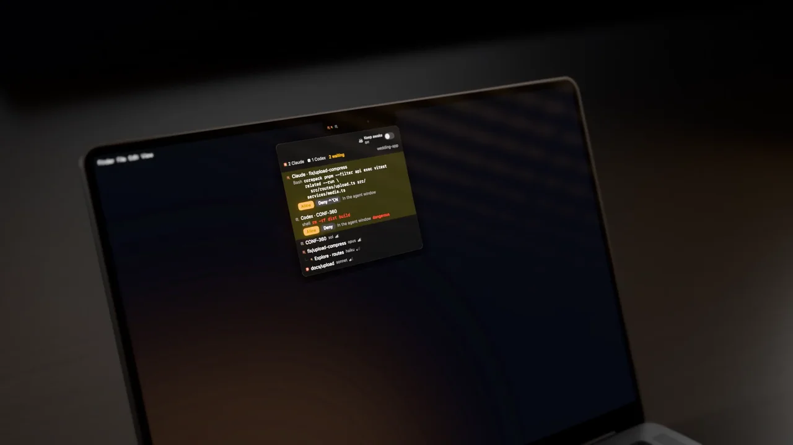
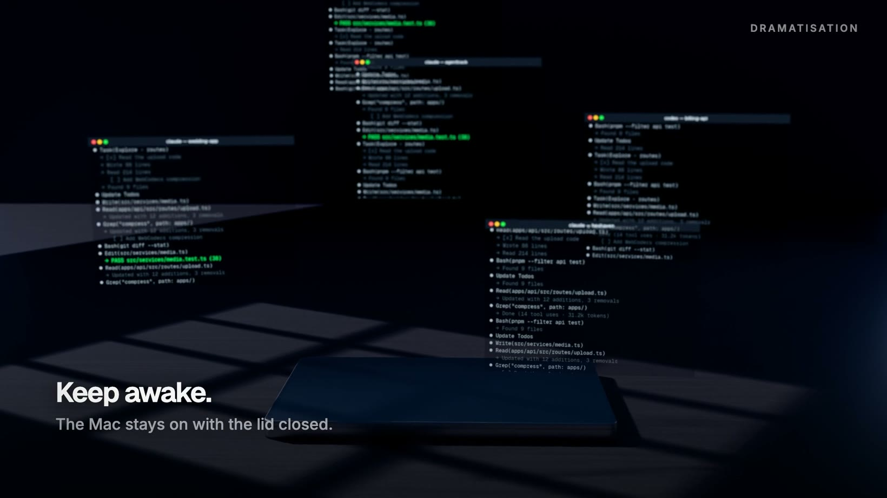

<div align="center">

<picture>
  <source media="(prefers-color-scheme: dark)" srcset="assets/readme/hero-dark.svg">
  
</picture>



[Смотреть ролик (72 с)](https://github.com/user-attachments/assets/e0233797-1f4f-46ff-a82c-b08d428b05c9) · [English](README.md)

</div>

Крыло слева от «чёлки» MacBook. Показывает, какие агенты Claude Code и Codex работают на этом Mac, в каких проектах и кто кого запустил. Данные берутся только из локальных журналов сессий: `~/.claude/projects/**` и `~/.codex/sessions/**`. Приложение их читает и ничего никуда не отправляет.

## Установка

```bash
brew install --cask forichok/tap/agent-notch
```

Или скачайте DMG из [Releases](https://github.com/Forichok/Agent-Notch/releases/latest) и перетащите Agent Notch в «Программы». Приложение не нотаризовано, поэтому macOS не даст открыть скачанную копию с первого раза: выполните `xattr -dr com.apple.quarantine "/Applications/Agent Notch.app"` или откройте его один раз и нажмите «Всё равно открыть» в «Системных настройках» → «Конфиденциальность и безопасность». Homebrew делает это сам. Нужна macOS 14 и Apple Silicon.

## Что на экране

В крыле одна метка на агента:

- логотип — вендор: Claude или Codex, берётся из приложения, установленного на Mac;
- яркость — вес модели: полная у opus, sonnet, sol и astra, приглушённая у haiku и luna;
- точка — состояние: зелёная работает, жёлтая мигает (ждёт вас), красная застряла на ошибке, серая — агент закончил.

В настройках вместо логотипов можно включить точки (кружок Claude, квадрат Codex, кольцо у лёгких моделей) или логотипы цветом состояния.

Субагенты рисуются мельче и прижаты к родителю. Если в проекте больше шести живых агентов, вместо меток показываются счётчики «● 6 ■ 7», а ждущие и упавшие остаются отдельными метками. Если меню активного приложения доходит до крыла или всё не помещается в 130 pt, крыло сворачивается в одну сводку.

Клик открывает список. Сверху блок «требует внимания», ниже проекты, сессии и их субагенты с моделью и эффортом (четыре палочки: low, medium, high, xhigh). Под работающим агентом серым написано, что он делает сейчас: `Bash · pnpm test`, `Edit · src/app.ts`. Клик по строке открывает чат в приложении Claude или Codex через `claude://resume` и `codex://threads`. Если приложения нет, сессия продолжается в Terminal командой `claude --resume` или `codex resume`.

Правый клик (или ctrl-клик) открывает меню: хуки, ответы из чёлки, звук, автозапуск, сжатие по меню и выход. На экране без «чёлки» вместо крыла появляется обычный значок в строке меню.

## Работа с закрытой крышкой



Тумблер **«Без сна»** находится справа сверху в списке агентов. Он управляет системной настройкой `pmset disablesleep` и показывает состояние, прочитанное из macOS. Режим действует на весь Mac и сохраняется после выхода из Agent Notch, пока вы не выключите тумблер. Выключайте его перед тем, как убрать Mac в сумку.

Чтобы переключать режим без ввода пароля каждый раз:

1. Нажмите правой кнопкой на крыло и откройте **Настройки → Общие → Без сна**.
2. Нажмите **«Настроить»** рядом с **«Переключение без пароля»** и подтвердите разрешение.
3. Один раз введите пароль администратора в системном окне macOS.

Приложение добавит `/private/etc/sudoers.d/agent-notch-keep-awake-<UID>` — правило для вашего пользователя ровно на две команды: `/usr/bin/pmset disablesleep 0` и `/usr/bin/pmset disablesleep 1` от root без пароля. Этим правом сможет пользоваться любой процесс вашего пользователя. Правило проверяется через `visudo`; основной файл sudoers не меняется.

В настройках показано, установлено ли правило, и результат последней проверки доступа. **«Проверить доступ»** проверяет разрешение с текущим значением настройки сна. Если другая политика sudo требует пароль, приложение сообщит, что правило не действует.

Чтобы удалить правило, нажмите **«Удалить разрешение»** в этом же разделе настроек и подтвердите пароль администратора. Удаление разрешения не меняет текущий режим сна: для этого выключите тумблер **«Без сна»** в панели. Разрешение остаётся и после удаления приложения, поэтому удалите его в настройках до удаления приложения. Если приложение уже удалено, убрать правило можно в Terminal:

```bash
sudo rm "/private/etc/sudoers.d/agent-notch-keep-awake-$(id -u)"
```

Без этого разрешения тумблер продолжает работать через обычный системный запрос пароля. Отдельно запускать `caffeinate` не нужно.

## Разрешения из чёлки

С установленными хуками агент, которому нужно разрешение, не ждёт молча в терминале. Список открывается сам, звучит сигнал, в строке видно инструмент и команду целиком. Дальше три варианта:

- «Разрешить» или ⌃⌥Y;
- «Отклонить» или ⌃⌥N;
- «В окне агента» — вопрос уходит обратно в Claude Code или Codex, как будто приложения нет.

Горячие клавиши отвечают на самый старый запрос и только когда список открыт и этот запрос виден в нём хотя бы полсекунды. Иначе клавиша просто открывает список. Команда всегда показана целиком, до 12 строк, ровно в том виде, в каком её получит агент. Команды вроде `rm -rf`, `sudo`, `git push --force` и `git reset --hard` подсвечены красным. Их, как и многострочные, длинные или пустые запросы (например, вызов MCP без аргументов), можно разрешить только кликом. ⌃⌥A открывает и закрывает список.

Если за 100 секунд никто не ответил или приложение не запущено, хук молча выходит, и агент спрашивает у себя как обычно. Разрешение без клика человека не выдаётся никогда. Каждое решение записывается в `~/Library/Application Support/AgentsNotch/decisions.jsonl`.

Хуки ставятся из меню или командой ниже. Записи добавляются в `~/.claude/settings.json` и `~/.codex/hooks.json`, чужие хуки и порядок ключей не трогаются, файл до первой правки остаётся рядом как `*.agents-notch-backup`. Если файл — символическая ссылка, правится файл, на который она указывает; права доступа сохраняются. Codex запускает новые хуки только после проверки: откройте Codex, введите `/hooks` и отметьте `notch-hook` как доверенный.

```bash
"/Applications/Agent Notch.app/Contents/MacOS/AgentsNotch" --install-hooks
"/Applications/Agent Notch.app/Contents/MacOS/AgentsNotch" --uninstall-hooks
```

Хук — маленькая программа `notch-hook`, её копия лежит в `~/Library/Application Support/AgentsNotch/`. Она передаёт событие приложению через сокет `notch.sock` (доступен только вашему пользователю) и без приложения завершается за миллисекунды.

## Промпты и скиллы по горячей клавише

⌃⌥P открывает поиск под чёлкой поверх любого приложения. ↩ вставляет сохранённый промпт туда, где стоит курсор, ⌘↩ только копирует, ⌘1…9 выбирает по номеру строки. Первыми идут промпты, которые вы чаще использовали в последнее время.

⇥ переключает на скиллы: все, что могут загрузить Claude Code и Codex, — свои, встроенные, из плагинов и из проектов (проекты берутся из `~/.claude.json` и `~/.codex/config.toml`). ↩ вставляет вызов: `/name`, `/plugin:name` или `$name`.

Настройки → «Промпты и скиллы»: библиотека (добавить, изменить, дублировать, порядок перетаскиванием), статистика вставок (всего, по дням за 14 дней, самые частые) и вкладка «Скиллы» с описанием, полями заголовка, файлами, самим SKILL.md и тем, сколько раз Claude Code вызывал скилл по его логам.

Вставка идёт через буфер обмена и ⌘V, который приложение нажимает само, поэтому нужен «Универсальный доступ». Без него промпт копируется. Прежнее содержимое буфера возвращается сразу после вставки. Промпты хранятся в `~/Library/Application Support/AgentsNotch/prompts.json`.

## Сборка и запуск

Нужен Xcode. Command Line Tools не подходят: в них компилятор не совпадает с SDK.

```bash
sudo xcode-select -s /Applications/Xcode.app/Contents/Developer
./scripts/build.sh        # build/AgentsNotch.app, подпись ad-hoc
./scripts/test.sh         # проверки NotchCore, код выхода 0 — всё прошло
open build/AgentsNotch.app
```

SwiftPM (`Package.swift`) тоже описан, но скрипты собирают через `swiftc` напрямую.

Флаги запуска:

| Флаг | Что делает |
|---|---|
| `--fixture one\|sub\|multi\|projects\|heavy\|ask` | показывает выдуманную сцену вместо журналов |
| `--cramped` | всегда сворачивает крыло в сводку |
| `--open-list` | открывает список при старте |
| `--snapshot <папка>` | рисует все сцены в PNG и выходит |
| `--snapshot-live <файл.png>` | один раз читает журналы, рисует PNG и выходит |
| `--install-hooks`, `--uninstall-hooks` | ставит или снимает хуки Claude Code и Codex и выходит |

## Как определяется состояние

- Для Claude Code главный источник — его собственный файл статуса в `~/.claude/sessions`: `busy`, `idle` или `waiting`. Если процесс закрыт, сессия и её субагенты сразу становятся серыми. Журналы нужны для остального и для Codex.
- **Работает:** ход не закончен и в журнале была запись за последние 5 минут, либо идёт долгий инструмент (до 30 минут).
- **Ждёт:** пришёл запрос разрешения через хук, Claude показал свой диалог подтверждения, Codex записал запрос на подтверждение или Claude вызвал `AskUserQuestion` / `ExitPlanMode`.
- **Ошибка:** три неудачных вызова инструмента подряд.
- **Закончил:** ход завершён, субагент отдал отчёт родителю или журнал молчит. Через 30 минут тишины сессия пропадает из списка.

Проект определяется по корню git, поэтому worktree попадает в свой основной репозиторий.

## Ограничения

- Без хуков сессия Claude Code, которая ждёт подтверждения, видна как ждущая, но ответить из чёлки нельзя и неясно, на что именно. Это видно только у главной сессии: субагент, который ждёт, без хуков выглядит работающим.
- Пока хук держит запрос (до 100 секунд), Claude Code может не показывать свой диалог. Если вы отвечаете в терминале, выключите в меню «Решать запросы из чёлки»: запросы будут сразу уходить агенту, а крыло продолжит показывать, кто ждёт.
- Codex-воркеры, которых Claude запускает через `codex-job`, видны отдельными сессиями того же проекта, без связи с родителем.
- Сжатие по меню работает только с доступом Accessibility. Подпись ad-hoc меняется при каждой сборке, поэтому доступ после пересборки придётся выдать заново.

## Устройство

- `Sources/NotchCore` — чтение журналов (`LogScanner`, `Parsers`, `SessionLog`), дерево проектов (`Tree`), раскладка крыла (`Wing`), хуки (`Hook`, `HookServer`, `HookState`, `HookInstaller`), тестовые сцены. Без AppKit.
- `Sources/NotchHook` — `notch-hook`, который запускают агенты.
- `Sources/AgentsNotch` — AppKit и SwiftUI: окно крыла, панель списка, горячие клавиши, `MenuWatcher`, снимки.
- `Tests/CoreChecks` — проверки без XCTest на поддельных журналах во временной папке.
